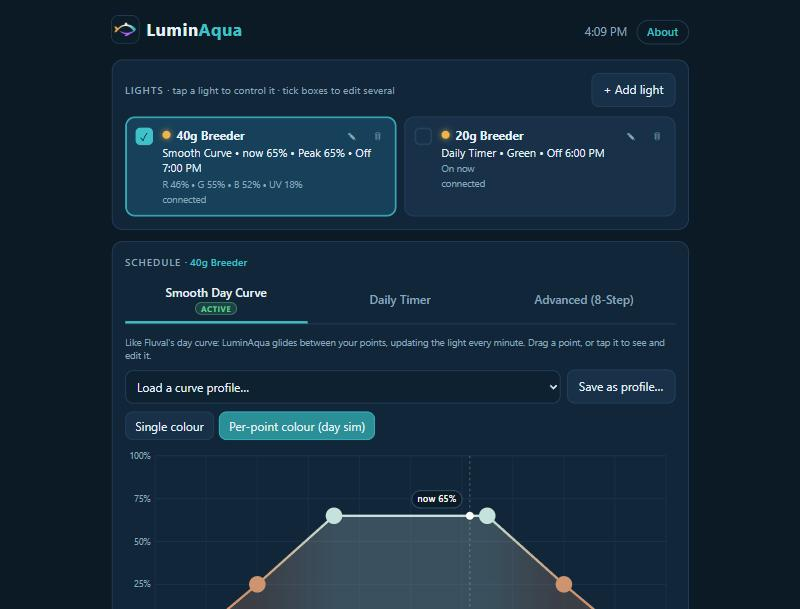
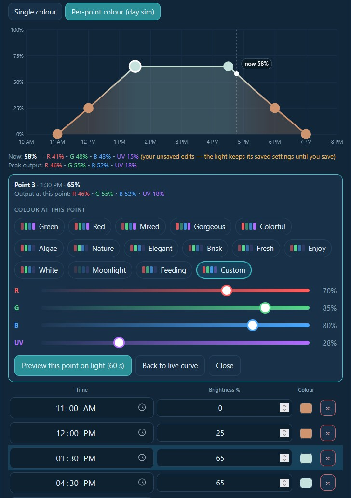
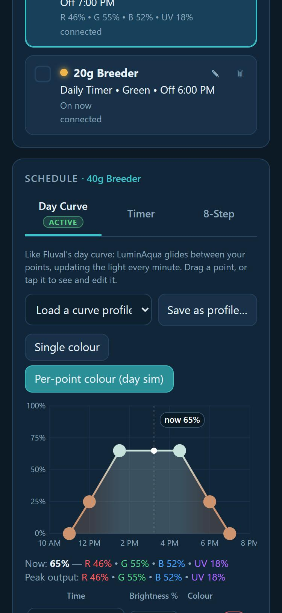
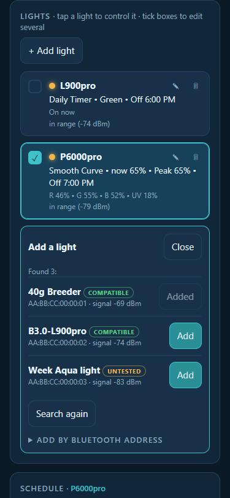
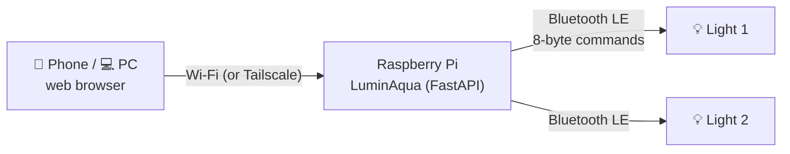
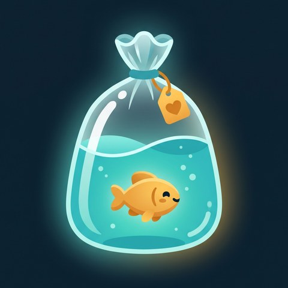

<div align="center">


# LuminAqua

**A better, local, Fluval-style controller for WEEK AQUA Bluetooth aquarium lights — running on a Raspberry Pi.**

Smooth sunrise-to-sunset curves · per-point colour "day sim" · every light on one page, alone or all at once · works from any phone or PC on your Wi-Fi

[](LICENSE)




</div>

> [!NOTE]
> LuminAqua is an independent, unofficial project. It is **not affiliated with, endorsed by, or supported by WEEK AQUA**.
> "WEEK AQUA" and model names are used only to say which lights this works with.

---

## Why

The official WEEK AQUA app can only do two things: switch a light on/off at fixed times with one colour, or run
an 8-step schedule where the light **jumps** between levels. There's no gradual ramp you can shape, no per-tank
memory on your phone, and only one phone can be connected at a time.

LuminAqua turns a Raspberry Pi next to your tanks into a 24/7 controller that drives the lights itself:

- **🌅 Smooth Day Curve** — drag anchor points (e.g. 0% at 11 AM → 65% at 2 PM → 0% at 7:30 PM) and LuminAqua glides
  the light between them, updating it every minute. No more snapping from 20% to 50%.
- **🐟🐟 All your lights, one page** — every light in one place instead of connecting to them one by one. Tap a
  card to change just that tank, or tick several and control them **all at once**: lights up for feeding, the same
  curve on every tank, or everything off with one tap. Each tank still keeps its own schedule, and LuminAqua warns you
  before you overwrite tanks that run different ones.
- **🎨 Per-point colour ("day sim")** — give each point its own colour: a warm, UV-free sunrise that morphs into
  crisp midday daylight and back. R, G, B and UV are each interpolated independently.
- **🔢 Exact readouts** — see the precise R/G/B/UV output now, at every point, and at the peak (great for keeping UV in check).
- **👁 Preview any point** on the real tank for 60 seconds, then it returns to the live curve automatically.
- **📁 Profiles** — save curves like "40g Breeder – Balanced" and swap between them; two low-UV starter templates included.
- **⏱ Everything the official app does, too** — daily timer with sunrise/sunset fade, all 12 factory colour presets,
  custom colours, the 8-step advanced mode, and temporary "on for 1 hour" overrides.
- **🔌 Same power limit as the official app** — custom colours can't push the light past its power budget;
  a meter shows how much of it a colour uses, and sliders stop at 100 %.
- **🛟 Fail-safe** — the light's own off-timer is always set to the end of your curve, so if the Pi dies or Bluetooth
  drops, the light still switches itself off on time. Weak links get automatic retries and periodic re-sends.
- **📱 No app, no account, no cloud** — it's a web page served by the Pi. Open it on any phone or computer on your
  Wi-Fi (and from anywhere with the optional Tailscale extra).

<table>
<tr>
<td width="44%"></td>
<td width="28%"></td>
<td width="28%"></td>
</tr>
<tr>
<td align="center"><sub>Day-sim curve editor</sub></td>
<td align="center"><sub>On a phone</sub></td>
<td align="center"><sub>Finding your lights</sub></td>
</tr>
</table>

## Compatible lights

LuminAqua speaks the Bluetooth protocol of WEEK AQUA's **"WEK" family** (lights that advertise manufacturer ID `0x4657`).

| Status | Lights |
|---|---|
| ✅ Tested | **B3.0-L900pro**, **P6000pro** |
| 🟢 Should work | Other WEEK AQUA lights the "+ Add light" search marks **Compatible** |
| ⚪ Not supported | Devices it marks **Not supported**: other WEEK AQUA families (reef and multi-channel lights, smart plugs and others) use different commands |

Got another model working? Please [open an issue](../../issues) so it can be added to the list.

## What you need

- A **Raspberry Pi with built-in Bluetooth**, within Bluetooth range of your lights. Developed and tested on a
  **Pi 4**; a Pi 3, 5 or Zero 2 W should work the same way. The page shows each light's signal strength.
- A microSD card (8 GB+) and **Raspberry Pi OS** (Bookworm or newer; "Lite" is plenty).
- Your lights powered on, and the **official app closed** — a light that's connected to a phone is invisible to everything else.

## Install

**1. Flash the card.** In [Raspberry Pi Imager](https://www.raspberrypi.com/software/) choose Raspberry Pi OS Lite,
then *Edit settings*: set the hostname to `luminaqua`, a username and password, your Wi-Fi, **your time zone**
(the lights take their clock from the Pi), and enable SSH.

**2. Install LuminAqua** — SSH in (`ssh <user>@luminaqua.local`) and run:

```bash
sudo apt-get install -y git
git clone https://github.com/n72826/luminaqua.git
cd luminaqua/luminaqua && bash setup-pi.sh
```

The setup script updates the OS, switches Bluetooth on, creates a Python environment, and installs LuminAqua as a
service that starts on boot. Re-run it any time to update (`git pull` first).

**3. Open it** at **<http://luminaqua.local>** (or the Pi's IP address) on your phone or computer, tap
**+ Add light**, and name each light after its tank.

> [!TIP]
> On iPhone, open the page in Safari and choose *Share → Add to Home Screen* — it then opens full-screen like an app.

## Using it

| Tab | What it does | Who runs it |
|---|---|---|
| **Smooth Day Curve** | Your drawn curve, glided minute by minute. Single colour, or per-point colours. | LuminAqua (the light holds the current level and its own off-time as a fail-safe) |
| **Daily Timer** | The official app's "Mode setting": one colour, on/off times, optional 0.5–2.5 h fade. | The light itself |
| **Advanced (8-Step)** | The official app's "Advanced setting": up to 8 fixed periods. | The light itself |
| **Right now (temporary)** | On/off or any colour for 15 min – 4 h, then back to the schedule automatically. | LuminAqua |

The green **ACTIVE** badge shows which schedule the selected light is running. Tap a light card to edit just
that light; tick the boxes on several cards to edit them together.

## Remote access (optional)

Want to check the tank from work? [`extras/tailscale.sh`](extras/tailscale.sh) installs
[Tailscale](https://tailscale.com) from its official package source; afterwards LuminAqua is reachable on your
private tailnet from anywhere, with nothing exposed to the internet. Don't port-forward LuminAqua — it has no login.

## How it works



- Backend: Python, [FastAPI](https://fastapi.tiangolo.com/) and [bleak](https://github.com/hbldh/bleak); frontend:
  one dependency-free HTML file. Settings are kept in `luminaqua/state.json` on the Pi (the lights can't report
  their settings back, so LuminAqua remembers them).
- The full Bluetooth protocol is documented in **[PROTOCOL.md](PROTOCOL.md)**.
- LuminAqua **never** writes to the lights' firmware-update service.
- [`extras/weekaqua-cli.py`](extras/weekaqua-cli.py) is a small command-line tool for experimenting with the protocol.

## Troubleshooting

<details>
<summary><b>"+ Add light" finds nothing</b></summary>

- Close the WEEK AQUA app on every phone (or turn that phone's Bluetooth off) — a connected light stops advertising.
- Power-cycle the light and search again; move the Pi closer if the signal is weaker than about −85 dBm.
- Check Bluetooth is on: `bluetoothctl show` should say `Powered: yes` (if not: `sudo rfkill unblock bluetooth`).
</details>

<details>
<summary><b>A light shows an error / "not found"</b></summary>

Usually another device grabbed it. Close the official app, wait a minute, and try again — LuminAqua reconnects and
retries automatically. Logs: `journalctl -u luminaqua -f`.
</details>

<details>
<summary><b>Times are off by hours</b></summary>

The lights get their clock from the Pi. Set the Pi's time zone (`sudo raspi-config` → Localisation), then
`sudo systemctl restart luminaqua`.
</details>

## Development

```bash
cd luminaqua
python3 -m venv .venv && .venv/bin/pip install -r requirements-dev.txt
.venv/bin/python test_api.py        # offline tests, no Bluetooth needed
.venv/bin/uvicorn server:app --port 8000
```

From Windows, [`deploy.ps1`](deploy.ps1) copies the app to a Pi over SSH (`.\deploy.ps1 -PiHost luminaqua.local`).

## Contributing

I made LuminAqua to solve my own problem, and it was immediately clear it could help a lot of other people, so it's
free for everyone. If you want to improve on it, **please do. I encourage it.** Fork it, add the feature you've been
missing, and open a pull request so everyone gets it. Reports of other light models working (or not) are especially
welcome.

## 🐟 Help me buy more fish

Let's be honest: this hobby is expensive. Between fish, plants, CO₂, test kits and the next light I definitely don't
need, the tank always wins. If LuminAqua made your setup better, you can chip in toward my next fish. It's never
required, and LuminAqua stays free either way.

<a href="https://ko-fi.com/H3A62AWGP3"></a><br>
<a href="https://ko-fi.com/H3A62AWGP3"></a>

## How it was made

I built LuminAqua using [Claude](https://claude.ai). If that upsets you, well, no one is forcing you to use it. At the end of the day, I now have an app that controls my lights better than before and gets more out of lights I already paid for. The bonus for me is that I can share it with others and hopefully increase their quality of life too.

## License

[MIT](LICENSE). Use it, change it, share it.

This software is provided as-is, without warranty. Lighting affects living animals and plants — keep an eye on
your tank when you change schedules.
